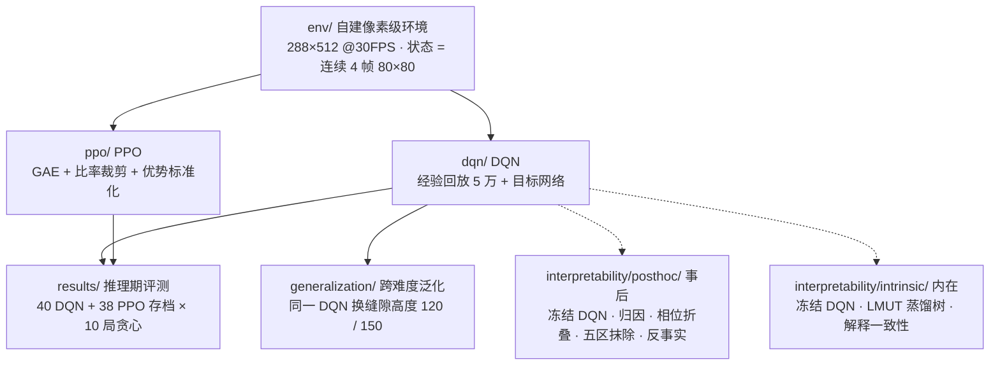
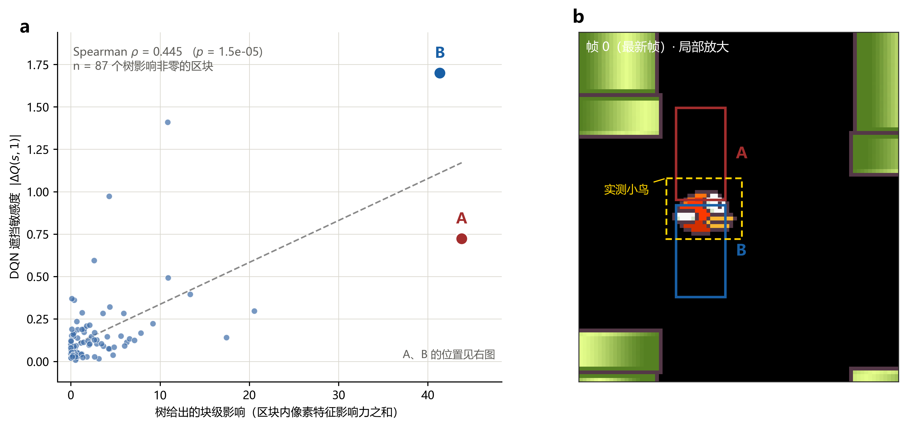

# Flappy Bird 深度强化学习智能体

**DQN / PPO 从零实现 · 跨难度泛化 · 事后与内在可解释性**

**作者**：DreamRoad

自建像素级 Flappy Bird 环境，从零实现 DQN 与 PPO 两条训练管线；诊断 DQN 的灾难性遗忘并与 PPO 对照；同一个 DQN 不微调、直接改缝隙高度做跨难度泛化；用五种归因 + 五区抹除 + 反事实干预做事后可解释性；把冻结的 DQN 蒸馏成可读的线性模型 U 树做内在可解释性。


**技术栈**：Python · PyTorch · pygame（自建像素级环境）· NumPy · TensorBoard · DQN（经验回放 + 目标网络）· PPO（GAE + 比率裁剪 + 优势标准化）· CNN 像素策略网络 · 归因（Saliency / SmoothGrad / IG / Occlusion / KernelSHAP）· 反事实干预 · LMUT

## 整体架构



两条训练管线共用同一个环境、同一套预处理与同一个 CNN 主干，只在算法上分叉；可解释性两条路线都以**训练后的 DQN 权重完全冻结**为解释对象。

---

## 主要结论

1. **训练与稳定性**：PPO 推理期平均 **2158.9** 分，DQN **118.8** 分（**18.2 倍**）。DQN 出现**灾难性遗忘**（75 万步 86.4 分 → 80 万步 5.0 分，95% 自助区间不重叠），PPO 同期未见跌回。
2. **跨难度泛化**：同一个 DQN 原样换缝隙高度，得分**非单调**——普通（120 px）**357.8** > 困难（训练档 100 px）**187.5** > 简单（150 px）**135.5**。
3. **事后可解释性**：模型主要依赖**地面带**（归因密度 3.63）与**小鸟**（2.90，唯一随管道相位剧烈起伏，同一周期内 0.92 → 9.29）；临死前 30 帧归因重心明显重排。因果上只有小鸟的**竖直**位移能改变拍翅决策。
4. **内在可解释性**：把 DQN 蒸馏成可读树，**71%** 分裂落在最新一帧，前 20 大影响像素有 **12 个**落在小鸟框内；树认定的关键区域与 DQN 自身的遮挡敏感度显著正相关（Spearman ρ = 0.65，p = 1.5×10⁻⁵，n = 87）。

---

## 工作一　算法实现与训练诊断

同一套环境、预处理与 CNN 主干（3 层卷积 + FC 512），只在算法上分叉，确保性能差异只能归因于算法本身。

| | DQN | PPO |
|---|---|---|
| 类型 | 值函数（Q-learning） | 策略梯度 |
| 关键机制 | 经验回放 5 万 + 目标网络（每 10⁴ 步同步） | GAE(λ=0.95) + 比率裁剪 0.2 + 优势标准化 |
| 优化 | Adam，lr 1e-4 | Adam，lr 2.5e-4 线性衰减 |
| 推理期最佳平均分 | **118.8**（189 万步） | **2158.9**（186 万步） |

- **一处必须不对称处理的细节**：PPO 必须把输入归一化到 [0,1]（否则 critic 初始 V(s) ≈ 168 而真实回报仅 1~40，熵立刻塌缩）；DQN 可以不归一化。
- **跨难度泛化的解释（假说）**：缝隙变宽只放松下边界，而本策略的死亡多发生在下管道——普通档 120 px 两头都占（比训练档宽、又离得近）故最好；150 px 时约 5/8 的管道位置在训练中从未出现，分布漂移压过难度红利，故最差。与 Chen (CS229, 2015) 不矛盾：该文的"难度"同时改变了缝隙的**位置分布**。

 

*左：推理期完整学习曲线（40 个 DQN + 38 个 PPO 存档各评测 10 局，阴影为 95% 自助 CI）。右：同一 DQN 在三种缝隙高度下各 30 局的得分分布。*

## 工作二　事后可解释性

冻结 DQN、不修改任何权重，只把输入当可控变量，回答两个问题：**它看画面中的哪里**、**什么能改掉它的决策**。

- **归因密度**（该区归因份额 ÷ 面积份额，1 = 全图平均）：地面带 **3.63**、小鸟 **2.90**、下管道 0.53、上管道 0.18、背景残差 0.16。
- **相位结构**（45 局 89,423 帧按管道相位折叠）：小鸟是唯一随相位剧烈起伏的区域，φ≈24 达峰 **9.29**；阴性对照（随机重排相位标签）后 r 仅 0.031。
- **临死前重排**（17 次死亡对齐）：小鸟密度在 τ=3 达峰 **14.81**，地面带由 3.72 降至 **1.51**。
- **反事实干预**：只平移小鸟、让游戏自己重绘画面。**决定模型往哪边改变决策的是扰动的幅度与方向。** 把小鸟整体下移，模型更倾向拍翅；整体上移，更倾向不拍；在 |k| ≤ 6 内单调。横向同幅度几乎无影响（斜率差 8.3 倍）。

 

## 工作三　内在可解释性

把冻结的 DQN 当教师，蒸馏成一棵**线性模型 U 树（LMUT）**：对两个动作各建一棵树，叶节点存线性模型而不是常数，因此同样叶数下表达力更强、更易读。

- 拍翅树 **338 个分裂点**，其中 **71% 落在最新一帧**；影响最集中的像素 **74% 落在左上象限**，前 20 位影响像素有 12 个落在小鸟框内。
- **解释一致性**：树给出的区块影响与冻结 DQN 自身的遮挡敏感度（两套相互独立的机制）在 **87 个区块**上 **ρ = 0.65（p = 1.5×10⁻⁵）**，说明读到的解释来自 DQN 本身，而非代理模型自身的偏好。

 

---

## 目录结构

```
.
├── dqn/                      DQN：网络、回放池、训练 / 评估 / 曲线
├── ppo/                      PPO：同主干，算法不同
├── env/                      自建 pygame 像素级环境（288×512 @ 30 FPS）
├── interpretability/
│   ├── posthoc/              事后可解释性：归因 / 相位折叠 / 五区抹除 / 反事实
│   └── intrinsic/            内在可解释性：LMUT 蒸馏树
├── generalization/           跨难度泛化评估
├── results/                  评测数据（json / csv）与绘图脚本
├── assets/
│   ├── figures/              README 全部配图
│   └── sprites/ · audio/     游戏素材
└── docs/                     核心代码讲解
```

## 快速开始

```bash
pip install -r requirements.txt

# 训练（--no-render 关闭窗口渲染，提速数十倍）
python dqn/train.py --no-render --fresh
python ppo/train.py --no-render --fresh

# 看训练好的智能体玩
python dqn/play.py --episodes 10

# 跨难度泛化：同一 DQN，只改缝隙高度、不微调
python generalization/gap_eval.py --gap 120 --episodes 30 --out generalization/out/gap120.json
```

> 必须在**仓库根目录**运行：游戏素材按相对路径 `assets/sprites/...` 读取。

## 数据与模型权重

`results/` 与各模块 `out/` 下为评测数据与图表数据。模型权重（`*.pt`，合计约 4.5 GB）体积过大未入库，训练时会写入 `runs/`。

## 参考

- Kevin Chen. *Deep Reinforcement Learning for Flappy Bird*. CS229 Final Report, Stanford, 2015.
- Liu et al. *Toward Interpretable Deep Reinforcement Learning with Linear Model U-Trees*. ECML PKDD, 2018.
