# Flappy Bird：强化学习训练与策略解释

**DQN / PPO · 跨难度评测 · 输入归因与位置干预 · 线性叶代理树**

基于 [DeepLearningFlappyBird](https://github.com/yenchenlin/DeepLearningFlappyBird) 的游戏环境与素材，以 PyTorch 实现 DQN 和 PPO，围绕“策略学得怎样、决策依赖什么、能否用可读模型解释”开展三项工作。项目包括训练实现、冻结策略评测与可解释性分析。


## 核心工作与结果

| 工作 | 实现与分析 | 本次实验的主要观察 |
|---|---|---|
| 一：训练与评测 | DQN、PPO；检查点评测；跨难度测试 | 扫描检查点的最高平均得分分别为 118.8、2158.9；冻结 DQN 的跨难度得分非单调 |
| 二：策略行为解释 | 五种输入归因、区域遮挡、相位分析、位置干预 | 小鸟区域的重要性随相位变化；所测边界帧上，竖直位移呈现比水平位移更明确的方向性响应 |
| 三：代理模型解释 | 双动作线性叶树、特征影响、路径高亮、遮挡对照 | 拍翅树约 71% 分裂位于最新帧；建立特征影响、局部路径与教师遮挡响应的对照流程 |

## 工作一：算法实现与评测

### 训练设置

输入为连续四帧组成的状态，每帧处理为 80×80 二值图；动作为拍翅或不拍翅。存活、过管、死亡奖励分别为 0.1、1、−1。DQN 使用经验回放与目标网络，PPO 使用 GAE、策略概率比裁剪与优势标准化。实现支持无窗口训练、TensorBoard 日志及模型和优化器状态恢复。

两个算法分别训练约 200 万环境步。DQN 使用原像素尺度，PPO 将像素归一化至 [0,1]，其他训练设置也不完全相同，因此本实验不单独识别算法本身的因果效应。训练期得分含探索行为，推理期使用确定性动作，两条曲线的统计口径不同。

<table><tr><td width="50%">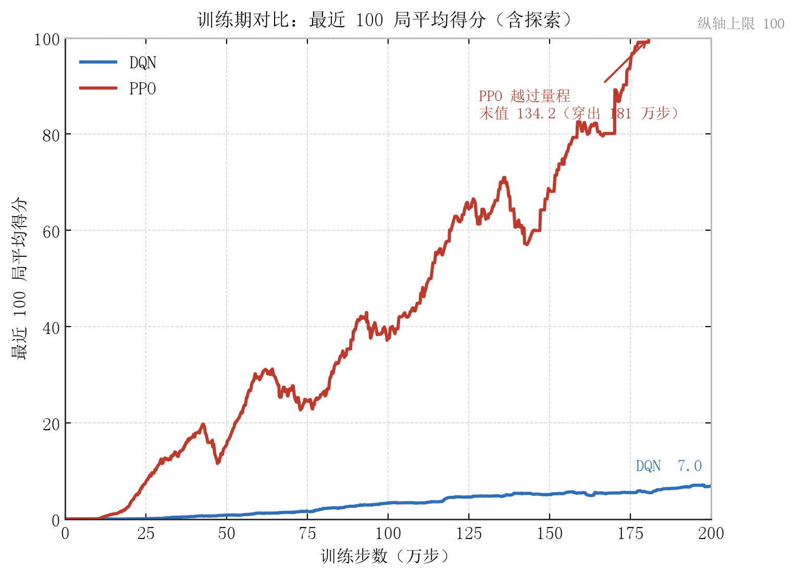</td><td width="50%"></td></tr><tr><td>训练期：最近 100 局平均得分。</td><td>推理期：固定检查点各评测 10 局，区间为按回合 bootstrap 得到的 95% 区间。</td></tr></table>

### 检查点表现与跨难度评测

共评测 40 个 DQN 和 38 个 PPO 检查点，每个 10 局，共 780 局。

| 算法 | 最高均分对应环境步 | 平均得分 | 该检查点单局最高分 |
|---|---:|---:|---:|
| DQN | 1,890,000 | 118.8 | 495 |
| PPO | 1,860,000 | 2158.9 | 4291 |

以上为扫描后的最佳检查点，并非独立重复训练的平均结果。DQN 在 75 万至 80 万步的检查点评测中，均分由 86.4 降至 5.0，说明本次训练存在明显波动；仅凭该现象不能确证“灾难性遗忘”。后续解释分析统一冻结第 189 万步 DQN，不再训练。

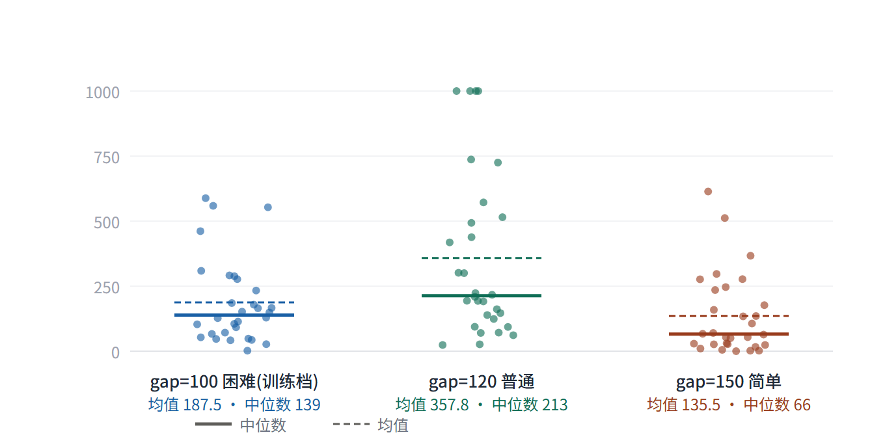

*固定模型，在管道缝隙 100、120、150 像素下各评测 30 局，平均得分分别为 187.5、357.8、135.5。120 像素设置中部分回合达到 1000 分停止上限。该评测与上表的 10 局检查点评测是两个独立批次。*

更宽缝隙同时改变容错空间和视觉输入分布，可能共同影响结果；当前实验没有将两者分离，因此仅得出“所测设置下得分非单调”的结论。

## 工作二：输入归因与位置干预

### 分析对象与采样口径

“帧”指被采样的时间点；网络在该时间点接收由当前帧和前三帧组成的状态。不同实验独立采样，样本数量不应互相替代。

| 分析 | 样本及设置 |
|---|---|
| 相位与位置干预 | 45 局、89,423 帧；17 局发生死亡，28 局达到每局 2500 帧上限 |
| 决策边界帧 | 在上述轨迹中筛选 `abs(Q(s,1) − Q(s,0)) < 0.5`，得到 41,867 帧 |
| 区域遮挡 | 另一批 45 局、99,030 帧；每 16 帧抽取 1 帧得到 6190 帧，补充 435 帧死亡前窗口样本，按回合和帧号去重后共 6625 帧 |
| 代理解释对照 | 从独立测试回合的采样帧中取 120 帧，进行分块遮挡 |

边界筛选将分析集中于两个动作价值接近、容易改变动作的情形，适合研究局部决策敏感性；所得翻转比例不代表所有游戏帧上的比例。帧之间存在时间相关性，按帧重采样的区间不等于按独立回合估计的不确定性。

### 输入归因与删除检验

对冻结模型的动作价值计算 Saliency、SmoothGrad、Integrated Gradients、Occlusion 和 KernelSHAP。归因回答“输入变化与当前输出有何关系”，不等于模型内部的注意力权重。

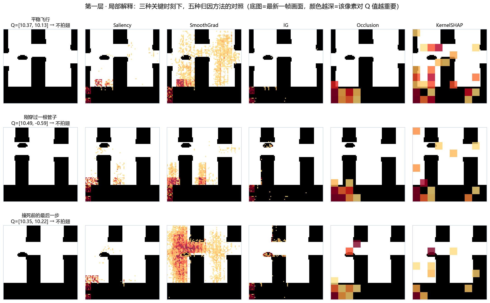

*五种归因方法揭示不同的局部敏感区域；图像方向沿用原始输入约定，显示时转换为屏幕坐标。*

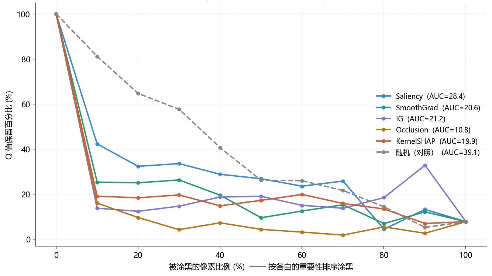

*按归因强度依次遮挡像素，记录动作价值保留曲线。下降更快说明排序在该遮挡规则下更能定位敏感输入；该检验依赖遮挡基线，不能证明解释唯一或完全忠实。*

区域归因密度定义为：

$$D_r=\frac{\text{区域 }r\text{ 的归因份额}}{\text{区域 }r\text{ 的面积份额}}.$$

密度 1 对应全图平均水平。以过管时刻对齐并划分 36 个相位区间，小鸟区域的平均密度在周期内约从 0.92 变化至 9.29；17 次死亡事件对齐后，死亡前 30 帧窗口中小鸟区域密度峰值为 14.81。这些是条件统计，不能据此认定该区域变化导致死亡。

<table><tr><td></td><td>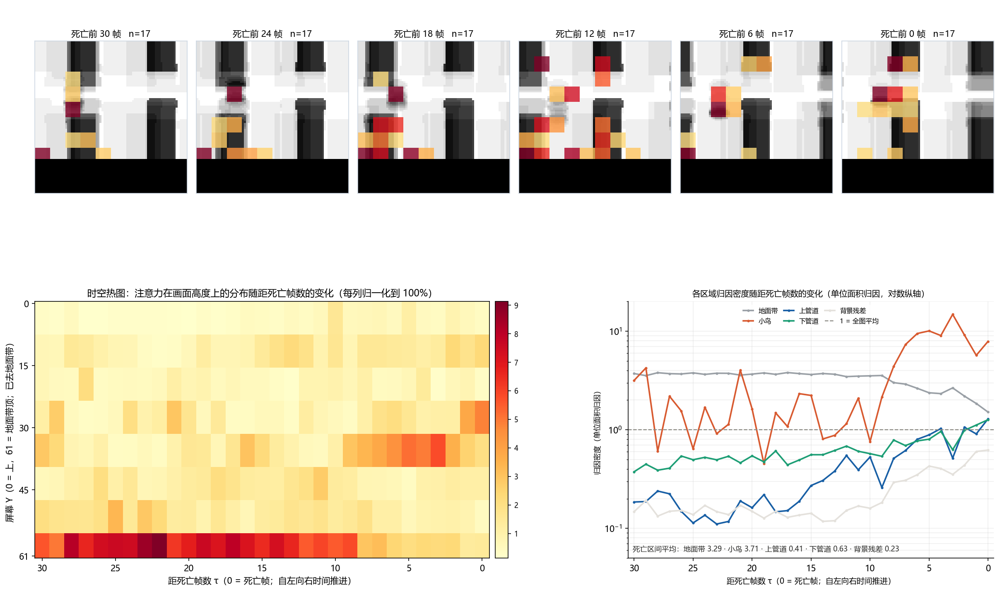</td></tr><tr><td>过管相位对齐揭示周期内的归因变化。</td><td>死亡事件对齐揭示失败前的局部敏感性变化。</td></tr></table>

### 区域遮挡与位置干预

区域遮挡在四帧输入中将对应区域置零，分别统计动作价值相对变化、单位面积变化和动作翻转率。这三个量的分母不同，不能互换。地面遮挡的原始价值变化较大，小鸟区域单位面积影响突出，下管道区域的动作翻转更明显。

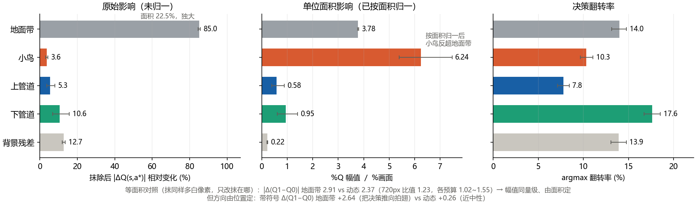

*区域遮挡反映对当前输入的敏感性；大面积遮挡也可能引入偏离正常游戏画面的输入。*

位置干预只改变小鸟在**最新帧**中的位置，使用游戏素材重新渲染，其余三帧历史保持不变。以

$$m(s)=Q(s,1)-Q(s,0),\qquad \Delta m=m(s')-m(s)$$

衡量拍翅倾向变化。再按小鸟是否与管道在水平方向重叠划分“管道内”和“管道间”，比较竖直位移与水平位移。屏幕坐标向下为正；历史图使用向上为正的展示约定，解读方向时须留意坐标。

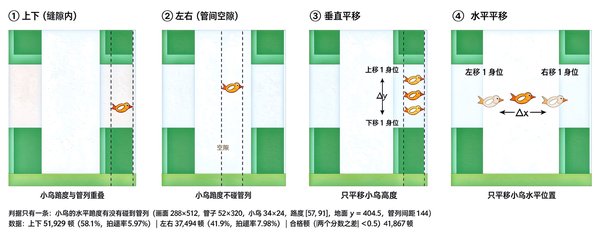

*干预保留管道、背景及历史帧，改变最新帧小鸟位置。历史零位移核验在 139 帧上与原渲染逐像素一致。*

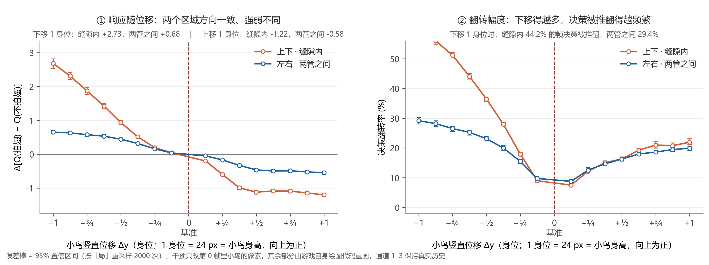

*所测边界帧中，小鸟下移通常提高拍翅倾向，上移则相反；管道内对部分竖直位移更敏感。*

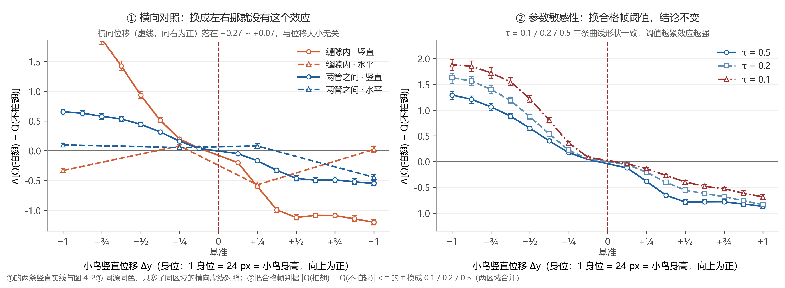

*水平位移未呈现同样明确的方向性趋势；收紧边界阈值至 0.2、0.1 后主要方向仍可观察。该结果不等于水平位置完全无影响。*

这里只测量即时动作价值和决策变化，没有执行干预后的完整轨迹；单帧改动可能破坏时间连续性。因此不将其解释为真实飞行动作的因果收益。

## 工作三：线性叶代理树与解释核验

### 代理拟合

借鉴 Linear Model U-Tree（LMUT）的线性叶结构，离线拟合冻结 DQN 的两个动作价值，每个动作一棵树。训练与最终测试使用不同回合；训练数据内部另留一部分帧用于开发。

四帧共 25,600 个二值像素特征，数据筛除近常量特征后保留 19,012 个。树按方差减少选择分裂，叶节点进行岭回归：

$$\widehat Q_a(s)=w_{\ell,a}^{\mathsf T}x+b_{\ell,a},\qquad
\min_{w,b}\sum_{i\in\ell}(Q_a(s_i)-w^Tx_i-b)^2+\lambda\|w\|_2^2.$$

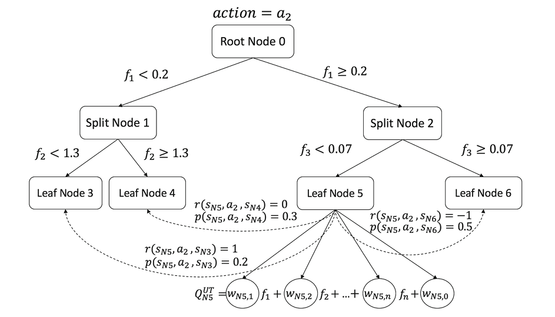

*结构示意沿用报告中的 LMUT 方法说明图；项目实现为离线双动作代理树。方法来源见文末参考文献。*

### 特征影响与路径高亮

设节点样本集合为 $N$，教师价值在节点内的方差为 $v_N$，左右子节点为 $L,R$：

$$\Delta v_N=v_N-\frac{|L|}{|N|}v_L-\frac{|R|}{|N|}v_R.$$

对在节点 $N$ 用于分裂的特征 $f$，定义：

$$I_{N,f}=\left(1+\frac{w_{N,f}^{2}}{\sum_jw_{N,j}^{2}}\right)[\Delta v_N]_+,\qquad
I_f=\sum_{N:\,\text{split}(N)=f}I_{N,f}.$$

节点回归使用筛选后的 1024 个特征；分裂特征不在该集合中时权重修正项取 0，权重平方和为 0 时也取 0。以全部保留特征（包括零影响特征）的平均影响作为高亮阈值。在具体样本从根到叶的路径上，只高亮满足阈值的分裂像素。

拍翅树含 339 个叶节点、338 次分裂，其中 241 次位于最新帧（约 71%）。这描述代理树的结构，不意味着 DQN 只依赖最新帧。

<table><tr><td></td><td>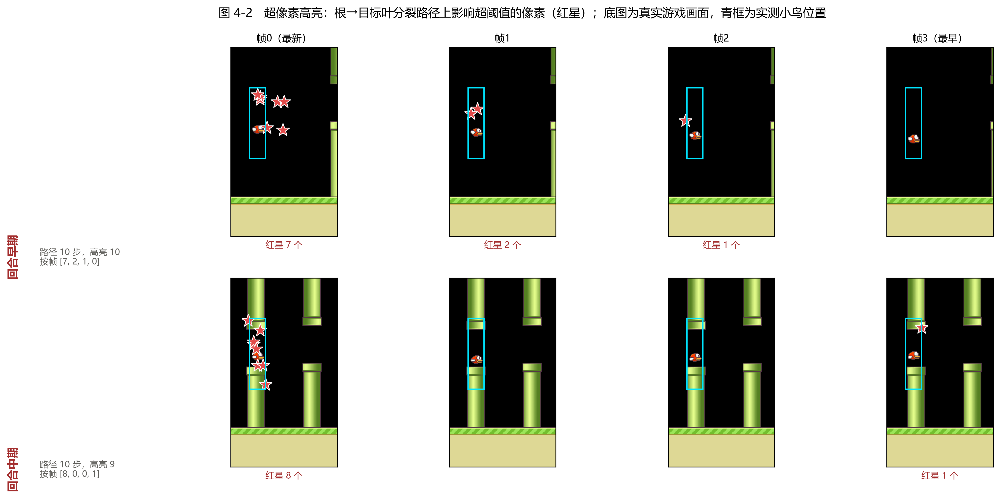</td></tr><tr><td>特征影响示例：展示分裂特征在四帧输入中的空间分布。</td><td>路径高亮示例：定位单次代理预测使用的关键像素条件。</td></tr></table>


### 代理影响与教师遮挡敏感度

从独立测试回合中抽取 120 帧时刻，每个时刻取连续四帧作为模型输入。各帧划分为 8×8 像素区块，四帧共 400 个区块。代理块影响为 $T_b=\sum_{f\in b}I_f$；教师敏感度为

$$D_b=\frac1n\sum_{i=1}^{n}|Q_1(s_i)-Q_1(M_b(s_i))|,$$

其中 $M_b$ 仅遮挡一个通道中的一个区块。将代理给出的区块影响与教师价值的变化配对，再回到游戏画面定位对应区域，检查两种分析是否关注相同的输入位置。

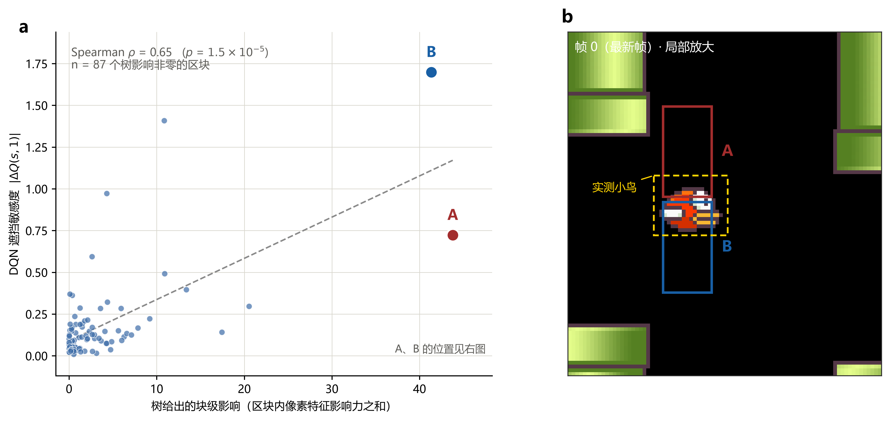

*区块对照示例。左图以区块为单位展示代理影响与 DQN 遮挡响应，右图标出 A、B 区块及小鸟位置，用于说明数值对照与空间定位的方法。*

## 安装与运行

建议 Python 3.10+；从仓库根目录执行。先按硬件安装 PyTorch，再安装依赖。CPU 可运行测试和小规模推理，完整训练及归因建议使用 GPU。

```bash
python -m pip install -r requirements.txt
python -m unittest discover -s tests -v
python dqn/train.py --no-render --fresh --max-steps 2000000
python ppo/train.py --no-render --fresh --max-steps 2000000
python dqn/eval_curve.py --episodes 10
python ppo/eval_curve_ppo.py --episodes 10
python generalization/gap_eval.py --help
```

权重保存在各训练脚本的 `runs/` 目录，默认解释检查点为 `runs/ckpt-1890000.pt`。指定检查点进行分析：

```bash
python interpretability/posthoc/explain_dqn.py --ckpt runs/ckpt-1890000.pt --episodes 45
python interpretability/posthoc/cf_regions.py --ckpt runs/ckpt-1890000.pt --episodes 45
python interpretability/posthoc/position_intervention.py --ckpt runs/ckpt-1890000.pt --episodes 45
python interpretability/intrinsic/surrogate.py --ckpt runs/ckpt-1890000.pt
```

`cf_regions.py` 执行区域遮挡分析，`position_intervention.py` 执行最新帧的位置干预，`surrogate.py` 完成代理拟合与区块对照，并支持通过 `--data` 复用已采集的数组。

## 目录结构

```text
dqn/                       DQN 训练、评测与游戏运行
ppo/                       PPO 训练、评测与游戏运行
env/                       游戏环境
generalization/            跨难度评测
interpretability/posthoc/  归因、区域遮挡、位置干预
interpretability/intrinsic/ 线性叶树与代理解释
results/                   历史逐回合结果与轻量日志
assets/                    游戏素材、原始示意动图和报告图片
tests/                     索引、数值计算、渲染一致性检查
```


## 来源与许可

- 游戏环境与素材：[yenchenlin/DeepLearningFlappyBird](https://github.com/yenchenlin/DeepLearningFlappyBird)，保留上游 MIT 声明，见 [LICENSE](LICENSE)。
- DQN：Mnih et al., *Human-level control through deep reinforcement learning*, Nature, 2015。
- PPO：Schulman et al., [Proximal Policy Optimization Algorithms](https://arxiv.org/abs/1707.06347), 2017。
- 代理树方法：Liu et al., *Toward Interpretable Deep Reinforcement Learning with Linear Model U-Trees*。方法示意图用于学术说明，来源与自有实现区分标注。
