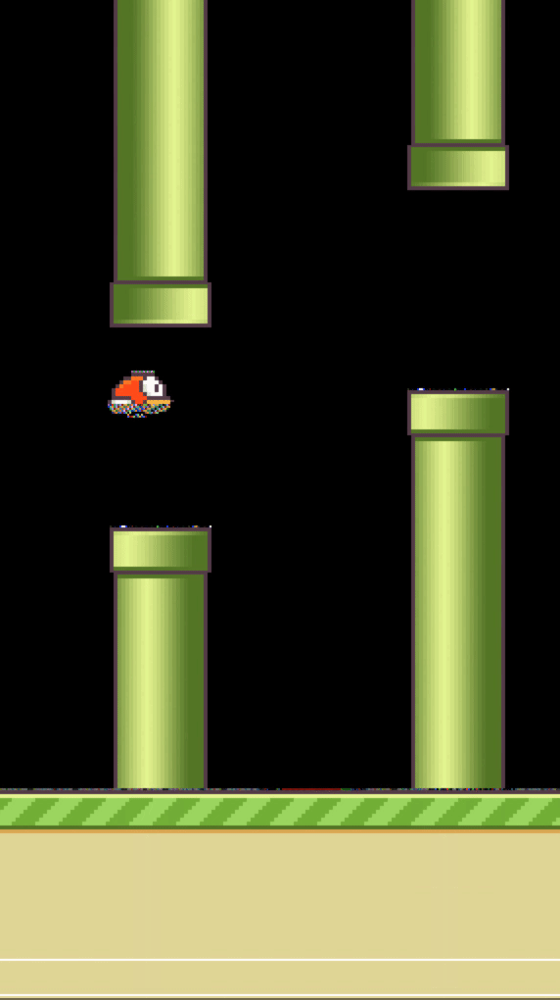
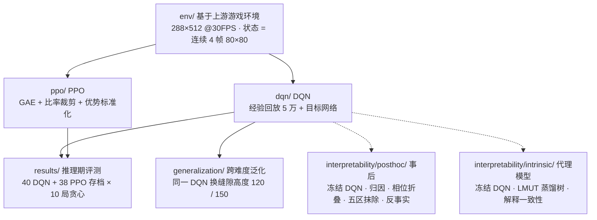
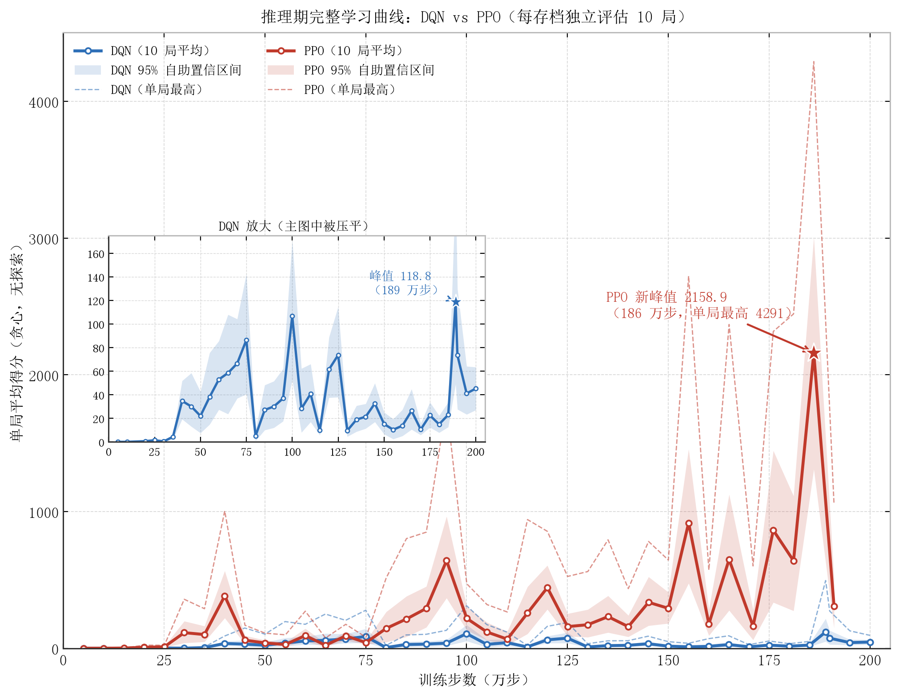
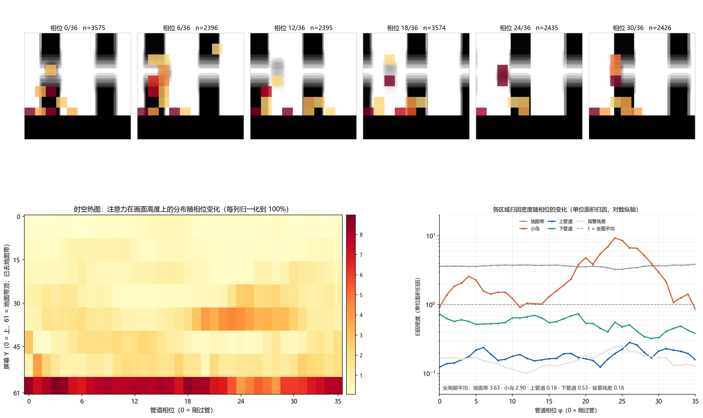
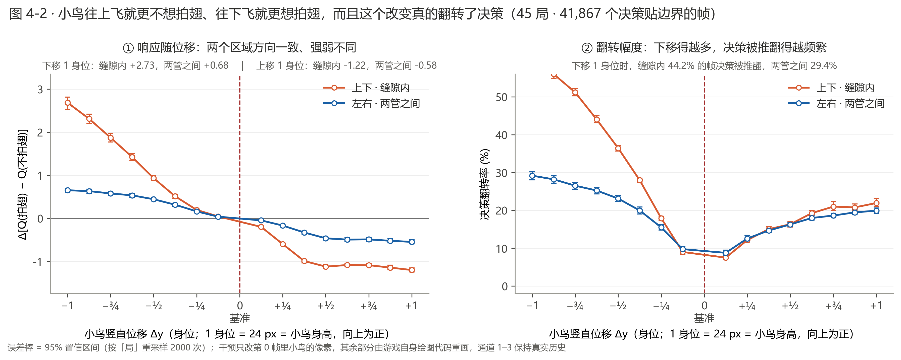
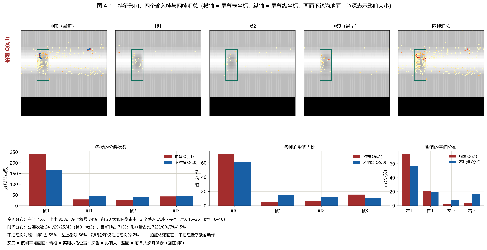

# Flappy Bird 深度强化学习智能体

**PyTorch DQN / PPO · 跨难度泛化 · 事后解释与内在可解释代理模型**

**作者**：DreamRoad

基于 [DeepLearningFlappyBird](https://github.com/yenchenlin/DeepLearningFlappyBird) 的游戏环境与素材，将其 TensorFlow DQN 思路用 PyTorch 实现并加入目标网络，另实现 PPO 训练管线；比较检查点表现，探索同一 DQN 不微调、直接改缝隙高度时的跨难度表现；用五种归因 + 五区抹除 + 反事实干预做事后解释；把冻结的 DQN 蒸馏成可读的线性模型 U 树，分析代理模型的内在结构及其与 DQN 遮挡敏感度的一致性。



**技术栈**：Python · PyTorch · pygame（基于上游游戏环境）· NumPy · TensorBoard · DQN（经验回放 + 目标网络）· PPO（GAE + 比率裁剪 + 优势标准化）· CNN 像素策略网络 · 归因（Saliency / SmoothGrad / IG / Occlusion / KernelSHAP）· 反事实干预 · LMUT

## 整体架构



两条训练管线共用同一个游戏环境，使用相近的 CNN 主干；输入缩放、初始化和训练更新等配置并不完全相同，因此下述分数是各自检查点在本实验设置下的表现，不能单独归因于算法。可解释性两条路线都以**训练后的 DQN 权重完全冻结**为解释对象。

---

## 主要结论

1. **训练与稳定性**：本次检查点扫描中，PPO 最高推理期均分 **2158.9**，DQN 为 **118.8**（两者比值 **18.2**）。DQN 的部分后期检查点出现性能回落（75 万步 86.4 分 → 80 万步 5.0 分，95% 自助区间不重叠）；PPO 在对应扫描中未见同样的回落。
2. **跨难度泛化**：同一个 DQN 原样换缝隙高度，本次探索性评测的得分**非单调**——普通（120 px）**357.8** > 困难（训练档 100 px）**187.5** > 简单（150 px）**135.5**。评测脚本的得分上限截断尚未按独立局重置，数值需在修正协议后复核。
3. **事后可解释性**：模型对**地面带**（归因密度 3.63）与**小鸟**（2.90，唯一随管道相位剧烈起伏，同一周期内 0.92 → 9.29）较敏感；临死前 30 帧归因重心明显重排。在所测位移与状态范围内，小鸟的**竖直**位移较容易改变拍翅决策，横向同幅位移影响较小。
4. **内在可解释代理模型**：把 DQN 蒸馏成可读树，**71%** 分裂落在最新一帧，前 20 大影响像素有 **12 个**落在小鸟框内；按作者重新运行的解释一致性实验，树的块级影响与冻结 DQN 的遮挡敏感度呈正秩相关（Spearman ρ = **0.65**）。树本身可读，但对原 DQN 的解释属于事后代理解释。

---

## 工作一　算法实现与训练诊断

两者使用同一游戏环境与相近的 CNN 主干（3 层卷积 + FC 512），但输入缩放及训练配置不同，以下对照仅描述本次实验观察，不能隔离算法本身的因果效应。

| | DQN | PPO |
|---|---|---|
| 类型 | 值函数（Q-learning） | 策略梯度 |
| 关键机制 | 经验回放 5 万 + 目标网络（每 10⁴ 步同步） | GAE(λ=0.95) + 比率裁剪 0.2 + 优势标准化 |
| 优化 | Adam，lr 1e-4 | Adam，lr 2.5e-4 线性衰减 |
| 推理期最佳平均分 | **118.8**（189 万步） | **2158.9**（186 万步） |

- **本实现中的输入处理差异**：PPO 将像素缩放到 [0,1]；未缩放版本曾出现 critic 初始 V(s) ≈ 168、而观测回报约为 1~40 的数值问题和策略熵快速下降。DQN 当前实现使用原像素尺度；这一差异也限制了算法间的直接归因。
- **跨难度泛化的解释（假说）**：缝隙变宽只放松下边界，而本策略的死亡多发生在下管道——普通档 120 px 两头都占（比训练档宽、又离得近）故最好；150 px 时约 5/8 的管道位置在训练中从未出现，分布漂移压过难度红利，故最差。与 Chen (CS229, 2015) 不矛盾：该文的"难度"同时改变了缝隙的**位置分布**。

 

*左：推理期检查点曲线（40 个 DQN + 38 个 PPO 存档各评测 10 局，阴影为 95% 自助 CI）。右：同一 DQN 在三种缝隙高度下各记录 30 条得分；其中达到人为得分上限后的环境未独立重置，右图按探索性结果解读。*

## 工作二　事后可解释性

冻结 DQN、不修改任何权重，只把输入当可控变量，回答两个问题：**它看画面中的哪里**、**什么能改掉它的决策**。

- **归因密度**（该区归因份额 ÷ 面积份额，1 = 全图平均）：地面带 **3.63**、小鸟 **2.90**、下管道 0.53、上管道 0.18、背景残差 0.16。
- **相位结构**（45 局 89,423 帧按管道相位折叠）：小鸟是唯一随相位剧烈起伏的区域，φ≈24 达峰 **9.29**；阴性对照（随机重排相位标签）后 r 仅 0.031。
- **临死前重排**（17 次死亡对齐）：小鸟密度在 τ=3 达峰 **14.81**，地面带由 3.72 降至 **1.51**。
- **反事实干预**：只平移小鸟、让游戏自己重绘画面。**决定模型往哪边改变决策的是扰动的幅度与方向。** 把小鸟整体下移，模型更倾向拍翅；整体上移，更倾向不拍；在 |k| ≤ 6 内单调。横向同幅度几乎无影响（斜率差 8.3 倍）。

 

## 工作三　内在可解释代理模型

把冻结的 DQN 当教师，蒸馏成一棵**线性模型 U 树（LMUT）**：对两个动作各建一棵树，叶节点存线性模型而不是常数，因此同样叶数下表达力更强、更易读。

- 拍翅树 **338 个分裂点**，其中 **71% 落在最新一帧**；影响最集中的像素 **74% 落在左上象限**，前 20 位影响像素有 12 个落在小鸟框内。
- **解释一致性**：按作者重新运行的实验，在树影响非零的 **87 个区块**上，其块级特征影响与冻结 DQN 的输入遮挡敏感度呈正秩相关，报告 **ρ = 0.65**。新实验的原始输入与 p 值尚未随仓库公开；两种分析对部分关键区域的排序一致，为代理解释提供支持，但相关性本身不足以证明代理树完整复现了 DQN 的决策机制。



*解释一致性图由作者另行更新；当前仓库中的旧图暂不作为重新运行实验的配图。*

---

## 目录结构

```
.
├── dqn/                      DQN：网络、回放池、训练 / 评估 / 曲线
├── ppo/                      PPO：同主干，算法不同
├── env/                      基于上游 pygame 游戏环境（288×512 @ 30 FPS）
├── interpretability/
│   ├── posthoc/              事后可解释性：归因 / 相位折叠 / 五区抹除 / 反事实
│   └── intrinsic/            内在可解释代理模型：LMUT 蒸馏树
├── generalization/           跨难度泛化评估
├── results/                  评测数据（json / csv）与绘图脚本
├── assets/
│   ├── figures/              README 全部配图
│   └── sprites/ · audio/     游戏素材
└── docs/                     核心代码讲解
```

## 快速开始

```bash
pip install -r requirements.txt

# 训练（--no-render 关闭窗口显示；实际速度取决于硬件）
python dqn/train.py --no-render --fresh
python ppo/train.py --no-render --fresh

# 看训练好的智能体玩
python dqn/play.py --episodes 10

# 跨难度泛化：同一 DQN，只改缝隙高度、不微调
python generalization/gap_eval.py --gap 120 --episodes 30 --out generalization/out/gap120.json
```

> 必须在**仓库根目录**运行：游戏素材按相对路径 `assets/sprites/...` 读取。

> `dqn/play.py` 与 `generalization/gap_eval.py` 需要训练生成的 DQN 权重；仓库未附权重，克隆后须先训练并按脚本参数指定检查点。`--fresh` 会创建新的训练记录，运行前请确认输出目录。

## 数据与模型权重

`results/` 与各模块 `out/` 下为评测数据与图表数据。模型权重（`*.pt`，合计约 4.5 GB）体积过大未入库，训练时会写入 `runs/`。

## 来源与许可

游戏环境与部分素材基于 [yenchenlin/DeepLearningFlappyBird](https://github.com/yenchenlin/DeepLearningFlappyBird)；其原版使用 TensorFlow DQN。本项目的 PyTorch DQN（含目标网络）、PPO、检查点评测及解释分析是在此基础上的扩展。仓库 `LICENSE` 保留上游 MIT 版权和许可声明，并列出本项目增量版权；上游 README 提及的更早游戏及素材来源仍需按各自条款核对。

## 参考

- Kevin Chen. *Deep Reinforcement Learning for Flappy Bird*. CS229 Final Report, Stanford, 2015.
- Liu et al. *Toward Interpretable Deep Reinforcement Learning with Linear Model U-Trees*. ECML PKDD, 2018.
